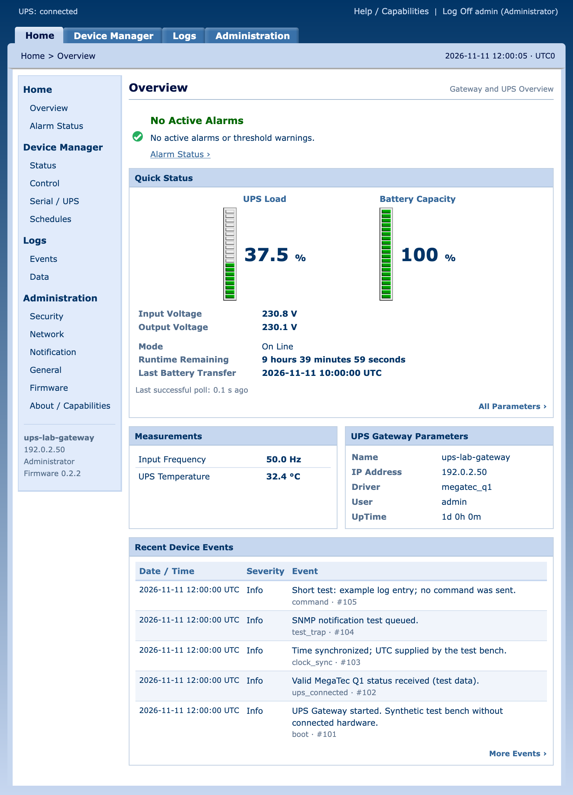
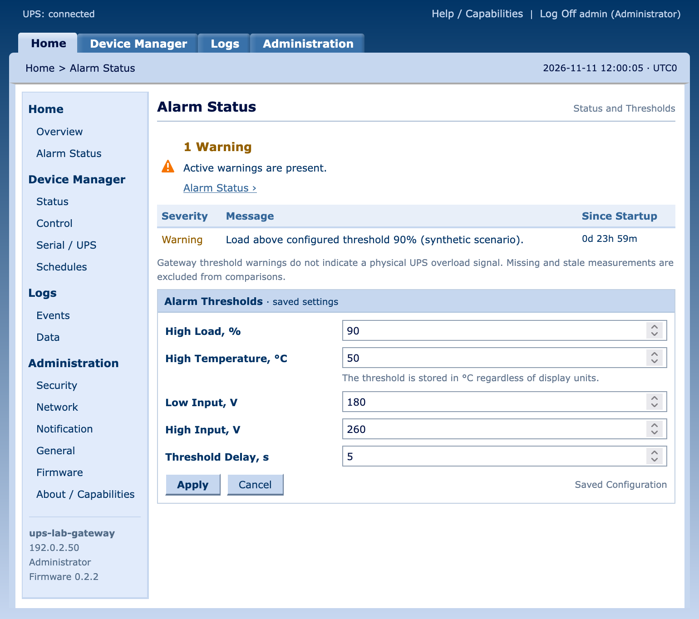
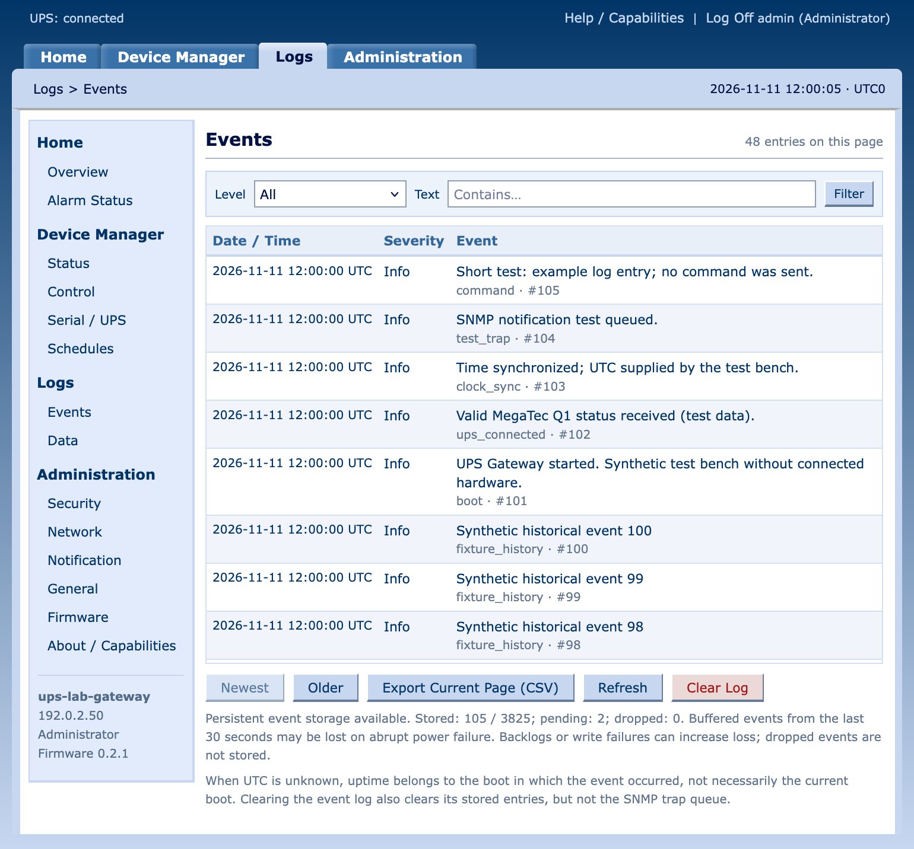
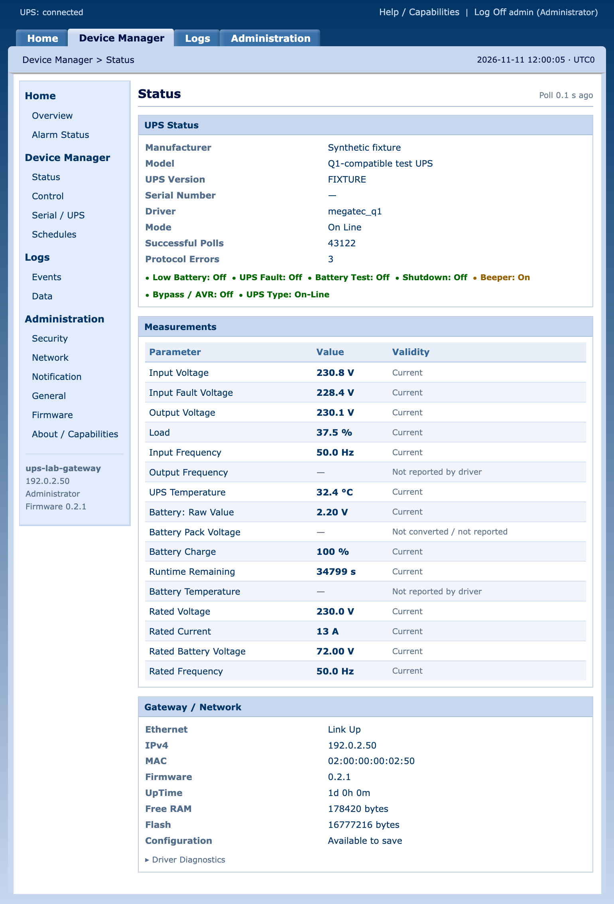
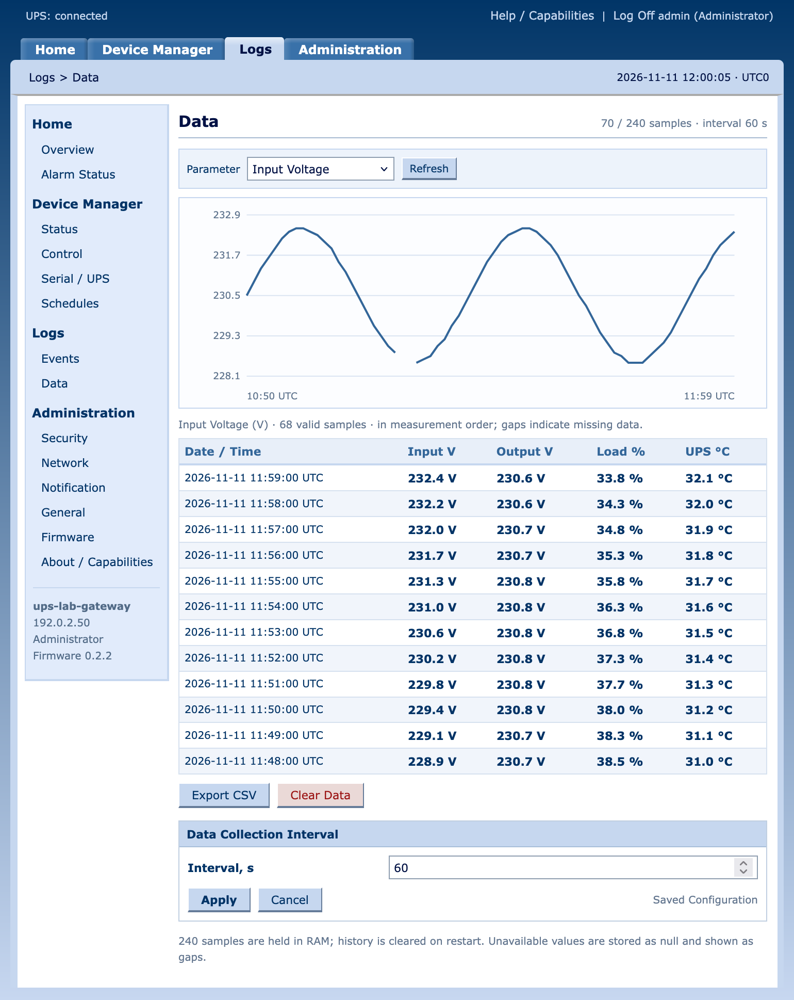
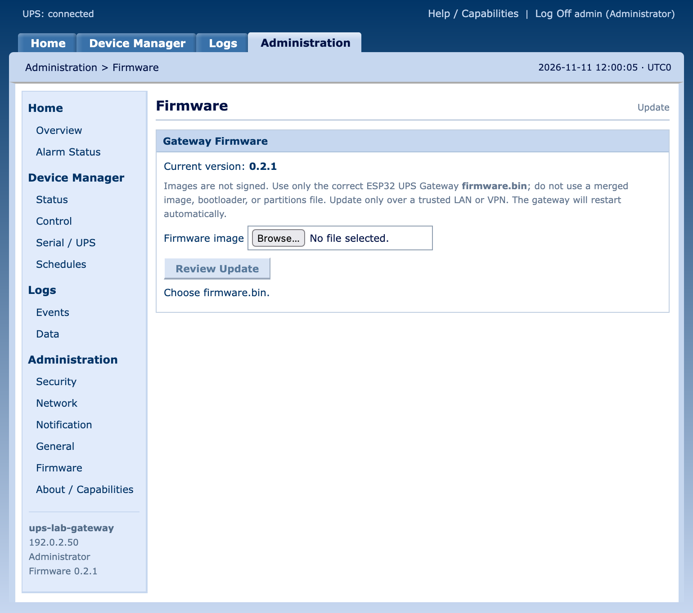

<h1 align="center">ESP32 UPS Gateway 0.2.2</h1>

<p align="center">
  <strong>Modular firmware for Olimex ESP32-POE / ESP32-POE-16MB with WROOM and 16 MB flash + MOD-RS232 on UEXT.</strong><br>
  Monitoring via APC PowerNet SNMPv2c, traps, web interface in English, UPS control through a separate UPS driver.
</p>

<p align="center">
  
  
  
  
  
</p>

<p align="center">
  
</p>

<p align="center">
  <sub>Screenshot rendered from the UI test fixture with synthetic data; not a hardware verification. Battery capacity and runtime are fixture values: with the MegaTec Q1 driver they appear only if the UPS answers the optional BT/BP queries (see <a href="docs/DRIVERS.md">docs/DRIVERS.md</a>). See <a href="#screenshots">Screenshots</a>.</sub>
</p>

> **Verification boundary:** the hardware results were recorded with firmware 0.2.1 on one ESP32-POE and Inform Sinus EVO 3000 combination; see [Tested hardware](#tested-hardware) for exactly what was and was not checked. Release 0.2.2 was verified on the same board by a web update from 0.2.1 (running slot `ota_1` to `ota_0`, new boot id, configuration and event log preserved, UPS communication resumed with 0 poll errors) and by a short and a timed battery test whose output status and event log were read over SNMP. The web label “On Battery (Self-Test)” was seen in the web UI during the timed test. Not verified on 0.2.2: automatic rollback of a bad image and an upload from a real browser. The screenshots use synthetic data. Control commands are disabled by default; monitoring starts automatically.

## Highlights

<table>
  <tr>
    <td width="33%" valign="top">🔌 <b>Network</b><br>Ethernet LAN8720, DHCP or static IPv4. No Wi-Fi configuration.</td>
    <td width="33%" valign="top">📡 <b>SNMPv2c</b><br>GET/GETNEXT/GETBULK, PowerNet MIB subset, UPS link status and traps; two trap receivers with separate communities and ports.</td>
    <td width="33%" valign="top">🖥️ <b>Web interface</b><br>Classic APC layout in English, embedded in the application; session login with administrator/operator/observer roles.</td>
  </tr>
  <tr>
    <td valign="top">🔋 <b>UPS driver</b><br>MegaTec Q1 driver for Inform Sinus EVO. Control via SNMP SET (compatible with NUT <code>snmp-ups</code>) is disabled by default.</td>
    <td valign="top">📊 <b>Alarms and history</b><br>Active alarms, configurable thresholds, event log with filter and CSV, 240-measurement RAM history with graph and CSV.</td>
    <td valign="top">🔄 <b>Updates</b><br>Two application OTA slots; configuration is stored separately and survives a normal update. A gateway still on 0.2.0 needs a one-time USB flash first; from 0.2.1 onward updating is ordinary (see <a href="#7-update-preserving-configuration">section 7</a>). Web update was verified on one physical board; automatic rollback has not been verified.</td>
  </tr>
</table>

The complete feature list is in [What's included](#whats-included).

## Screenshots

The screenshots below are rendered from the UI test fixture (`tests/ui_fixture.html`) with synthetic data in headless Firefox. They are illustrations of the interface, not a hardware verification: no physical UPS or ESP32 board was involved. See [9. New interface preview](#9-new-interface-preview).

<table>
  <tr>
    <td width="50%" valign="top" align="center">
      <a href="docs/screenshots/alarm-status-high-load.png"></a><br>
      <sub><b>Home / Alarm Status</b>: active warning and configurable thresholds (synthetic high-load state)</sub>
    </td>
    <td width="50%" valign="top" align="center">
      <a href="docs/screenshots/event-log.png"></a><br>
      <sub><b>Logs / Events</b>: level and text filter, paging, CSV export and storage status</sub>
    </td>
  </tr>
  <tr>
    <td width="50%" valign="top" align="center">
      <a href="docs/screenshots/device-status.png"></a><br>
      <sub><b>Device Manager / Status</b>: UPS status, measurements with validity, gateway and network details</sub>
    </td>
    <td width="50%" valign="top" align="center">
      <a href="docs/screenshots/history-graph.png"></a><br>
      <sub><b>Logs / Data</b>: RAM history graph, sample table, CSV export and collection interval</sub>
    </td>
  </tr>
  <tr>
    <td width="50%" valign="top" align="center">
      <a href="docs/screenshots/firmware-update.png"></a><br>
      <sub><b>Administration / Firmware</b>: update page for <code>firmware.bin</code></sub>
    </td>
    <td width="50%" valign="top">
      <b>Also in the interface</b> (not pictured): Control, Serial / UPS, Schedules, Security, Network, Notification, General, About / Capabilities.
    </td>
  </tr>
</table>

## Contents

- [Highlights](#highlights) and [Screenshots](#screenshots)
- [What's included](#whats-included)
- [Tested hardware](#tested-hardware)
- [1. Connecting hardware](#1-connecting-hardware)
- [2. Quick install of ready firmware](#2-quick-install-of-ready-firmware)
- [3. UPS primary setup](#3-ups-primary-setup)
- [4. Observium CE and traps](#4-observium-ce-and-traps)
- [5. Control](#5-control)
- [6. Build from sources](#6-build-from-sources)
- [7. Update preserving configuration](#7-update-preserving-configuration)
- [8. Modularity and verification](#8-modularity-and-verification)
- [9. New interface preview](#9-new-interface-preview)
- [Documentation](#documentation)
- [License](#license)

## What's included

- Ethernet LAN8720, DHCP or static IPv4, no Wi-Fi configuration.
- SNMPv2c GET/GETNEXT/GETBULK, PowerNet MIB subset and UPS link status.
- UPS control via SNMP SET through PowerNet control objects (compatible with NUT `snmp-ups`) with a separate Write Community; disabled by default.
- SNMPv2c traps: battery/mains, low battery/restoration, RS232 loss/restoration, startup and channel test.
- Web interface in classic APC layout: tabs, side menu, compact tables and vertical segment load bar. Resources are embedded in the application and do not require a separate filesystem upload.
- Login by session, administrator/operator/observer roles, logout and idle timeout; control command confirmation on a separate screen.
- Active alarms, configurable thresholds, event log with filter and CSV, 240-measurement RAM history with graph and CSV.
- NTP/manual time, POSIX time zone, one-off and weekly schedules for driver-supported commands, UDP syslog with a separate queue.
- Two trap receivers with separate communities and ports.
- Settings export/import, random SNMP community, web password recovery over USB.
- Two application OTA slots; configuration stored separately and survives a normal update.
- Prebuilt images on GitHub Releases, full source code, configuration integrity-checking install script.

No full copy of the APC network card or KPM220 is included here: SMTP, WoL, SNMPv3, INFORM, HTTPS, RADIUS, SSH/Telnet and FTP are not implemented. Firmware can be updated in two ways: over USB, or over HTTP by a logged-in administrator (the image goes to the inactive of the two OTA slots; a new image that does not bring up the configuration, Ethernet and an IP address within 120 seconds is rolled back by the SDK). A same-version web update (0.2.1 to 0.2.1) and a web update from 0.2.1 to 0.2.2 were verified on one physical board; automatic rollback has not been verified. See [Tested hardware](#tested-hardware) and [docs/OTA.md](docs/OTA.md). PDU outlets are not created from nothing: commands and data depend on the UPS driver. Function/API porting map — `docs/APC_PORT.md`.

## Tested hardware

Results below are from 2026-11-18 on the exact combination listed, not a claim for other models or sizes.

| UPS | Gateway board | Firmware | Verified | Not verified |
| --- | --- | --- | --- | --- |
| Inform Sinus EVO 3000, UPS firmware `V142B000D0`; `megatec_q1`, RS-232 2400 8N1 | Olimex ESP32-POE, ESP32-D0WD-V3 rev 3, 16 MB flash, MOD-RS232 | 0.2.1 | Q1 polling with 0 errors; `F` and `I` responses (nominal 220 V / 13 A / 72 V / 50 Hz and UPS firmware); read-only `BT`/`BP` (100% charge and 2820 s / 47 min runtime at 13–14% load); USB `update`; same-version web update; configuration and persistent event log preserved across restart; SNMP read (GET/GETNEXT/GETBULK); battery test start from the web UI (`test_deep`); test cancel over SNMP SET (`test_cancel`) | Automatic rollback of a bad image; other SNMP SET objects (output off, reboot/restart, beeper, turn-on/shutdown cancel, short test); SNMP traps; syslog; schedules; an update between two different firmware versions (run later, see the 0.2.2 row); an upload from a real browser; web-UI beeper, short test, timed test (run later on 0.2.2, see that row), output off/restart and shutdown cancel; deep-test completion at battery low; Sinus EVO 1000/2000 and any other UPS model or brand |
| Same UPS and gateway board as above | Same board | 0.2.2 | Web update from 0.2.1: whole `firmware.bin` posted as a logged-in administrator with the CSRF token; `{"ok":true,"rebooting":true}` after 5.0 s; running slot moved from `ota_1` to `ota_0` with a new boot id; reset reason `software restart`; still on `ota_0` after the 120 s verification window; `/api/config` unchanged; event log preserved (sequence continued after 51); UPS reconnected 2 s after boot with 106 polls and 0 errors; the weekly schedule re-armed; short battery test started over SNMP SET (`upsAdvTestDiagnostics` = 2, noError): `upsBasicOutputStatus` 15 for about 10 s, then 2, with `test_short` and “Test ended” in the event log; timed test started and cancelled from the web UI (`test_timed`, `test_cancel`), `upsBasicOutputStatus` 15 while it ran and 2 again at the cancel, and the web label “On Battery (Self-Test)” seen in the UI during the timed test | Automatic rollback of a bad image; an upload from a real browser; Sinus EVO 1000/2000 and any other UPS model or brand |

The journal reported “UPS extended query BT supported” and “UPS extended query BP supported”. SNMPv2c GET, GETNEXT and GETBULK returned 7 system objects and 22 PowerNet objects matching the web status at the same moment, including output status 15 during the test. Missing objects returned `noSuchInstance`; a wrong community and SNMPv1 received no answer. The deep test ran for about 22 minutes with utility present, from 15:54 until cancellation; the UPS test bit was set, reported charge fell from 100% to 53%, and runtime from 2820 s to 1500 s. It did not reach battery low. The SNMPv2c SET to `upsAdvTestRuntimeCalibration` (`1.3.6.1.4.1.318.1.1.1.7.2.5.0`) with value `3` returned `noError`; the journal recorded `test_cancel` queued, transmitted and then “Test ended”. Within 5 s the output status changed from 15 to 2 and the web status showed `test_running=false`.

## 1. Connecting hardware

During USB flashing **disconnect the Ethernet cable with PoE**. A regular ESP32-POE has no PoE galvanic isolation; this is a direct Olimex requirement. Perform primary flashing with RS232 disconnected, powering the board from USB. MOD-RS232 converts levels but does not add galvanic isolation.

| Purpose | Connection |
| --- | --- |
| ESP32 TX | GPIO4 → UEXT pin 3 → MOD-RS232 |
| ESP32 RX | GPIO36 ← UEXT pin 4 ← MOD-RS232 |
| MOD-RS232 power | UEXT 3.3 V and GND |
| Ethernet | LAN8720, addr 0, MDC23, MDIO18, power12, clock GPIO17 OUT |

With a properly configured MOD-RS232, transmission goes to DB9 pin 2 and reception through pin 3. The official Sinus EVO 1–3 kVA manual also specifies pin 2 TX / pin 3 RX. For this revision you get a crossover cable:

| MOD-RS232 DB9 | Sinus EVO DB9 |
| --- | --- |
| 2 — TX | 3 — RX |
| 3 — RX | 2 — TX |
| 5 — GND | 5 — GND |

Check your UPS connector and revision. Do not carry over the old MegaTec 9/6/7 pinout from the protocol description onto Sinus EVO. This build is not intended for WROVER with a different Ethernet/PSRAM wiring. Details and primary sources: `docs/HARDWARE.md`.

## 2. Quick install of ready firmware

Download the prebuilt images from [GitHub Releases](https://github.com/D4rk4/esp32-ups-gateway/releases). To verify the three `.bin` files against `SHA256SUMS.txt`, put them together and run `sha256sum -c SHA256SUMS.txt` on Linux or `shasum -a 256 -c SHA256SUMS.txt` on macOS.

Python 3.10+ and your board's USB-UART driver are needed. Unpack the matching GitHub source archive and open a terminal in its `esp32-ups-gateway-...` directory. Create a `firmware/` directory there and put the downloaded images and `SHA256SUMS.txt` in it.

### Windows, PowerShell

```powershell
py -3 -m venv .venv
.\.venv\Scripts\python.exe -m pip install -r requirements.txt
.\.venv\Scripts\python.exe tools\flash.py --port COM5 install
```

Replace COM5 with your port. Venv activation is not required.

### Linux

```bash
python3 -m venv .venv
.venv/bin/python -m pip install -r requirements.txt
.venv/bin/python tools/flash.py --port /dev/ttyUSB0 install
```

The user must have access to the selected serial port. If there is a communication problem, you can add `--baud 115200` **before** `install`.

The script checks flash size (16 MB), local images, the new partition table and checksums; saves a raw copy of the configuration in `backups/`; writes bootloader, partition table and application at fixed addresses; resets only the OTA slot selection; reads the configuration area again and compares SHA-256. The chip stays in the bootloader until verification completes, so the first launch does not interfere with comparison. On success a restart is performed. `install` is installation or restore, not a check of old partition table compatibility; to transition from a previous version use `migrate` from section 7. On error check the message; normal operations do not erase the entire flash and do not reset settings automatically.

To view the plan without a board:

```bash
python tools/flash.py --dry-run install
```

### First launch and web interface login

**Important:** `firmware/firmware.bin` is rebuilt from current sources and contains the factory login described below. The hardware web updates described in [Tested hardware](#tested-hardware) did not verify a fresh installation or factory login. On updating, existing username and password are preserved and are not automatically changed.

For a new configuration in firmware built from current sources, the administrator username and password are `ups` / `ups`. These are publicly available weak credentials: immediately after logging in, replace the password with a unique one at least 12 characters long, and use only a trusted management network. An exception to the minimum length is allowed only for the exact factory pair `ups` / `ups`.

Open the USB console at **115200 baud**. For example:

```bash
python -m serial.tools.miniterm /dev/ttyUSB0 115200
```

On Windows use COM5 instead of `/dev/ttyUSB0`; take Python from the created venv. On first launch the web credentials and random SNMP read community are printed. On a configuration read or write error the device uses a temporary random web password and does not replace saved data; these temporary credentials are printed to the USB console.

If the password is lost, the USB console command `reset-password` saves a new web password without changing other settings; then enter `reboot`. To obtain the SNMP community, log in to the web and perform an explicit configuration export containing secrets. For diagnostic output there are `status` and `help`.

Next disconnect USB, connect MOD-RS232/UPS and PoE. Find the gateway address in the switch/router DHCP leases by MAC or name `ups-gateway` and open `http://GATEWAY_IP/`. If configuration with USB connected is needed, use the Ethernet port **without PoE**. The web uses a login form and HTTP session, SNMP uses v2c; place the gateway in a trusted management network. TLS and SNMPv3 are absent in this version.

## 3. UPS primary setup

Initial parameters: driver `megatec_q1`, **2400 8N1**, period 2000 ms, response timeout 1200 ms, connection loss after 10000 ms.

1. Wait for the "Communication with UPS established" state and growth of the successful poll counter.
2. Compare input/output voltage, load, input frequency and temperature with UPS indication.
3. "Protocol diagnostics" shows the last accepted Q1 string and status bits.
4. If there is no connection, check the cable and UART parameters. Do not enable control commands to find the protocol.

Q1 alone does not report charge percentage or remaining runtime; the optional read-only `BT` and `BP` queries supply them when supported, otherwise they are unavailable. Both answered on the tested Sinus EVO 3000. Measured input frequency is not reported as output frequency. A general fault is not reported as battery replacement or selftest failure.

On the main page load is shown as a number and a vertical APC-style segment bar. The value is taken from `load_percent`, the threshold from current alarm parameters. On an unavailable/stale measurement the indicator becomes inactive: loss of connection is not shown as 0% load.

"Raw battery voltage" is shown separately. The default multiplier is 0: recalculated battery circuit voltage is not published in SNMP. If the response contains the whole circuit voltage, set 1. If the response unit and cell count are reliably known, set the corresponding multiplier. There is no automatic guessing of 24/48/72 V.

For Sinus EVO configurations specified by the owner, **with Q1 voltage on one 2-volt cell** the following multipliers are used:

| Model | Battery circuit | `battery_multiplier` |
| --- | --- | --- |
| Sinus EVO 1000 | 24 V, 2 × 12 V | 12 |
| Sinus EVO 2000 | 48 V, 4 × 12 V | 24 |
| Sinus EVO 3000 | 72 V, 6 × 12 V | 36 |

For example, 2.25 V × 36 = 81 V for model 3000. This is a conditional recalculation, not a separate measurement: nominal circuit 72 V is not equal to the current charging voltage. Do not apply these multipliers if Q1 already reports the voltage of the whole block or circuit. Charge and runtime are not calculated from one voltage alone; without driver data the line shows `Runtime remaining: —`.

**All configuration changes apply after a gateway restart.** Saved configuration and current working parameters are intentionally separated.

## 4. Observium CE and traps

Add the local device definition from `integration/observium/`: it recognizes `ESP32 UPS Gateway/...` by sysDescr and connects PowerNet-MIB. The gateway does not assign itself a specific APC model ID; sysObjectID is `0.0` until its own ID is assigned. Therefore installing the supplied definition is part of discovery setup.

Example verification from a computer with Net-SNMP installed:

```bash
snmpget -v2c -c 'YOUR_READ_COMMUNITY' 192.168.1.50 1.3.6.1.2.1.1.1.0 1.3.6.1.4.1.318.1.1.1.8.1.0
snmpwalk -v2c -c 'YOUR_READ_COMMUNITY' 192.168.1.50 1.3.6.1.4.1.318.1.1.1
```

`upsCommStatus` must be 1 on working exchange and 2 on its loss. Exact types, units and missing indicators are listed in `docs/OIDS.md`.

Control via SNMP (after setting Write Community and enabling control permissions), for example a short battery test:

```bash
snmpset -v2c -c 'YOUR_WRITE_COMMUNITY' 192.168.1.50 1.3.6.1.4.1.318.1.1.1.7.2.2.0 i 2
```

For NUT: driver `snmp-ups`, `mibs = apc`, `community` = Write Community; `upscmd -l` shows available commands. The object table is in `docs/OIDS.md`.

For events configure `snmptrapd` and a receiver in the ESP32 web interface. Traps usually arrive on UDP 162, polling on UDP 161. The package includes an example receiver and event-to-device binding via syslog. In CE you should not rely on the paid Syslog Alerting mechanism; the event log and external notifications are different functions. Detailed instructions: `integration/observium/README.md`.

The "Send test notification" button sends an explicitly marked test channel and does not control power. The `sent` counter only confirms UDP packet handover to the network stack. TRAP has no delivery acknowledgment.

## 5. Control

Regular command permission and power command permission are separate settings; both are disabled at first launch. Enable them after checking that your UPS supports the corresponding commands. Only operations declared by the driver are available.

| MegaTec Q1 operation | Command family |
| --- | --- |
| Toggle buzzer | Q |
| Short test | T |
| Test to battery discharge | TL |
| Timed test | Tnn, 1–99 minutes |
| Cancel test | CT |
| Cancel shutdown / restore output in supported state | C |
| Delayed output shutdown | Snn, delay 1–10 minutes; S.n — 12–54 s with step 6 |
| Shutdown and request output return | SnnRmmmm / S.nRmmmm, return in 3–9999 minutes |

Inform Sinus EVO capabilities and protocol, including what the UPS does not report and what cannot be configured over RS-232: `docs/SINUS_EVO.md`.

Power operations require additional confirmation on the page. `sent_unconfirmed` means "command sent, execution not confirmed". There are no retries of control commands on unknown result. Canceling shutdown is not a guaranteed cold start on any UPS.

If the PoE switch is powered from a controlled output, output shutdown can turn off the ESP32 itself. Power return must then be provided by the UPS itself or an independently powered gateway. The gateway scheduler cannot execute the next command while the gateway itself is without power.

### Schedules, time and logs

The schedules page supports up to eight rules: one-off at UTC or weekly in a given time zone. Time must be reliable, UPS connection fresh, and control and the specific operation permitted. A configured rule is saved together with the configuration and takes effect after a restart. Before saving, a separate verification screen is shown.

The scheduler does not execute missed commands retroactively. Before queuing an operation it saves a mark in NVS; on save error the command is not sent. At start and time jumps the execution window is suppressed so as not to repeat questionable operations. This is a no-resend guarantee in the described cases, not confirmation of execution by the UPS itself.

Measurement history is a RAM ring of 240 records; at a 60-second interval up to four hours, after a restart it is lost. The event log is also stored in a separate flash partition: paginated CSV export is available, see [PERSISTENT_LOGS.md](docs/PERSISTENT_LOGS.md). Recent events may remain in the buffer and be lost on sudden power-off; storage state and overflow are shown by the interface. Every start records a `startup` event whose message names the reset reason, for example `Gateway started; reset reason: task watchdog` (reasons: power-on, external reset, software restart, panic, interrupt watchdog, task watchdog, other watchdog, deep sleep, brownout, SDIO reset, unknown). Panic, watchdog and brownout resets are recorded with warning severity, so a crash that restarted the gateway stays visible in the event log without a USB console. The same text is printed on the USB console at boot and is carried in the coldStart trap and in syslog. Event clearing does not clear the SNMP trap queue. UDP syslog, like traps, does not confirm delivery.

The administrator configures the system; the operator reads data and sends permitted UPS commands; the observer only reads data. Background reading updates do not extend the session timeout without human action. All permission restrictions are enforced server-side, independently of button visibility in the browser.

## 6. Build from sources

The same `requirements.txt` installs PlatformIO and esptool. Command:

```bash
python tools/build.py
```

Run it with Python from venv. For example, on Windows:

```powershell
.\.venv\Scripts\python.exe tools\build.py
```

The script disables PlatformIO telemetry, builds the target, verifies images and updates `firmware/` together with checksums. On first build internet is required for pinned dependencies.

PlatformIO Core 6.1.18, espressif32 6.12.0, Arduino ESP32 2.0.17, ArduinoJson 6.21.5 are pinned. The web page is automatically compressed and embedded into the application; `uploadfs` is not needed. Page source — `web/index.html`.

### Release packaging

`python tools/build.py` remains a normal build and does not pass release checks. If the ZIP path is already taken (including by a symlink) or `dist/` is a symlink, `python tools/package_release.py` stops before checks, moves nothing and deletes nothing; the old archive must be removed manually. Otherwise the command creates a temporary snapshot, verifies images and performs local snapshot checks. Until at least one of them has status `PASS`, the command returns a nonzero code without a new ZIP. On success the verified ZIP is published without overwriting an existing file. Protection covers accidental conflicts and parallel packagers, but not intentional replacement of `dist/` by the same user during a run. Diagnostics without packaging: `python tools/release_gate.py`. There is no check bypass.

Project sources in `src/`, `lib/`, `web/`, `tools/`, `integration/` are checked, including C++ headers, PHP, Arduino `.ino` and JavaScript in `web/index.html`. Unknown extensions block release. The fingerprint includes all ZIP files, tests and gate configuration; old reports are not accepted. Output contains commands, versions of available tools, fingerprints and statuses. Snapshot modification during checks blocks packaging; subsequent working tree changes do not get into the archive. The archive exactly matches the verified snapshot, but the snapshot is not guaranteed to reflect a single moment of a tree being edited simultaneously. Code changes after building firmware also require rebuilding: source matching an already built image is not confirmed by this fingerprint.

Semgrep uses only local rules `tools/semgrep-release.yml`, without a cloud rule set and telemetry; any match blocks release. This is a small baseline set for unsafe C copying, Python shell calls, dynamic JavaScript execution and PHP code/shell execution calls — **not a full security check**. Trivy locally scans sources and `requirements.txt`; any vulnerability, secret, configuration error or license finding blocks release. The detected package list must exactly match pinned dependencies. Gate places its own interpreter directory first in the PATH of child processes. Any license entry is considered a finding and causes `FAIL`; absence of entries means license data is not confirmed and causes `BLOCKED`. Therefore under the current rule Trivy gate cannot obtain `PASS` while `requirements.txt` contains pinned packages, until the owner defines allowed licenses and dependency coverage for PlatformIO, which Trivy currently does not recognize. Trivy may download a vulnerability database; sources and results are not sent. Missing database, timeout, error or incomplete report blocks release.

100% of executable lines and branches by integer counters of each own file is required, CRAP strictly less than 10, no unconfirmed duplicates with similarity from 0.8, and no surviving/uncovered mutations at a nonzero number of executed mutations. Installed Crapper, Dryer and Mutator do not support own C/C++ and embedded HTML/JS; available test runners also do not provide full coverage of these files. Therefore these checks currently honestly return `BLOCKED`, and a release ZIP is not created. Partial Python checks are not evidence of firmware quality or real hardware testing.

## 7. Update preserving configuration

When transitioning from 0.1.0, schema 1 configuration is read and supplemented with schema 2 fields in memory. Passwords, communities and other old values are preserved. The read itself does not overwrite the blob; the new schema is written on explicit save. Downgrade after writing schema 2 is not supported by old firmware: first use the raw copy made before updating.

**Upgrading from 0.2.1 to 0.2.2 is an ordinary update**, by web upload or USB `update`; configuration is preserved and no one-time step is needed. **A gateway still on 0.2.0 needs the one-time USB flash described next, before any web update**; that flash installs whichever release image you write, so for this release write 0.2.2. Release 0.2.2 adds the `battery_test` output mode (`/api/status` `output_mode`; PowerNet `upsBasicOutputStatus` 15 only for a battery test with utility present and 3 for a real outage during a test; the web interface shows “On Battery (Self-Test)”), a header tab strip without gaps and a yellow load gauge above 50 %. The 0.2.1 to 0.2.2 web update and the `battery_test` output mode (over SNMP and in the event log) were verified on the lab board (see below); the web label “On Battery (Self-Test)” was seen in the UI during the timed test.

**Upgrading from 0.2.0 to 0.2.1 needs one USB flash; do not use web upload for this step.** Test uploads to a 0.2.0 device restarted the gateway with no HTTP response and before a new slot was selected, so the new image never started. The likely cause is a stack overflow: the 0.2.0 firmware upload handler keeps its 4 KB read buffer on the 8 KB HTTP task stack, and the computed call depth on that path exceeds the stack; no crash log was captured to confirm it. 0.2.1 moves the buffer to the heap. A 0.2.1-to-0.2.1 web update was subsequently verified on one physical board; automatic rollback remains unverified. Write the first image of 0.2.1 or later (for this release, 0.2.2) over USB with the commands below (`update` if the device already has the OTA table, `migrate` if it still has the old single `factory` table), and **disconnect the Ethernet cable with PoE first**, as described in section 1.

On 2026-11-18, the listed ESP32-POE ran 0.2.1 from `ota_0` after a USB `update`. An administrator used `curl` to POST the 0.2.1 `firmware.bin` (1,049,840 bytes) to `/api/firmware` with the same headers as the UI. After about 6 s it returned `{"ok":true,"rebooting":true}`; within about 10 s the gateway was reachable with a new boot ID, running from `ota_1` and reporting “Gateway started; reset reason: software restart”. Web update was offered again and the gateway remained on `ota_1` after the 120 s confirmation window. Configuration and the persistent event log were preserved, and UPS communication resumed with 0 poll errors. This did not verify automatic rollback, an update between different versions, or an upload driven by a real browser.

Later on 2026-11-18, the same board ran 0.2.1 from `ota_1` (boot id `095b9849`, output mode `online`). An administrator used a script to POST the 0.2.2 `firmware.bin` (1,049,952 bytes) to `/api/firmware` with the same headers as the UI (CSRF token, `Content-Type: application/octet-stream`, `X-Firmware-Confirm: UPDATE`). It returned `{"ok":true,"rebooting":true}` after 5.0 s. The gateway came back as 0.2.2 from `ota_0` with a new boot id (`8bc79cc7`) and the startup event “reset reason: software restart”; it was still on `ota_0` at uptime 215 s, after the 120 s verification window. `/api/config` was identical before and after (compared by hash), the event log was preserved (sequence numbers continued, 52 after 51), and UPS communication was re-established 2 s after boot, with the `BT` and `BP` queries answered again, 106 successful polls, 0 errors, output mode `online` and `needs_reboot` false. The saved weekly schedule rule re-armed after the boot safety window. No UPS command was sent, the UPS stayed online and the load was not interrupted. This did not verify automatic rollback of an image that fails verification, or an upload driven by a real browser (a script was used).

On the same 0.2.2 gateway, `sysDescr` read “ESP32 UPS Gateway/0.2.2; driver=megatec_q1; PowerNet subset”, `upsBasicOutputStatus` 2 and battery capacity 94 %. A short test was started by one SNMPv2c SET of `upsAdvTestDiagnostics` (`1.3.6.1.4.1.318.1.1.1.7.2.2.0`) = 2, answered with 2 (noError). The event log showed `test_short` “Command queued”, “Command transmitted”, “UPS test in progress” 1 s later and “Test ended” 11 s after the start; `upsBasicOutputStatus` read 15 (battery test with utility present) from about 1 s to 11 s after the SET and then 2 again, capacity stayed 94 % and the load was not interrupted. A timed test was also started and cancelled from the web UI: the log showed `test_timed` queued, transmitted and “UPS test in progress”, `upsBasicOutputStatus` read 15 while it ran, and `test_cancel` was queued and transmitted with “Test ended” in the same second, after which the status was 2 again and the load was not interrupted. This verified the 0.2.2 `battery_test` output mode on hardware as seen over SNMP and in the event log, and the web-UI `test_timed` and `test_cancel` commands. The owner saw the web label “On Battery (Self-Test)” during the timed test.

After receiving a new package version or running `tools/build.py`, perform a one-time USB transition from the old `factory` table:

```bash
python tools/flash.py --port /dev/ttyUSB0 migrate
```

For subsequent USB updates use:

```bash
python tools/flash.py --port /dev/ttyUSB0 update
```

On Windows specify `--port COM5`. `migrate` accepts only the exact previous table; `update` — only the new OTA table. An unknown table is rejected. Both commands save a raw `appcfg` copy in `backups/`, compare SHA-256 before and after, write the application to `ota_0` and only after successful write erase `otadata` so that the new application loads. `migrate` additionally writes the bootloader and then the table; `update` does not change them. Details on recovery after interruption and web update — in `docs/OTA.md`.

| Section | Address | Size | Purpose |
| --- | --- | --- | --- |
| nvs | 0x9000 | 20 KiB | ESP32 system parameters |
| otadata | 0xE000 | 8 KiB | OTA slot selection |
| ota_0 | 0x10000 | 4032 KiB | First application slot |
| ota_1 | 0x400000 | 4032 KiB | Second application slot |
| logs | 0x7F0000 | 1024 KiB | Raw ring of persistent event log |
| appcfg | 0xF00000 | 64 KiB | Gateway configuration |

`logs` is not a filesystem: it contains a persistent event log; measurement history remains in RAM. `logs` address and size are an update contract — do not move them in a new version. Ordinary `install`, `update` and `migrate` do not write or erase `logs`.

Settings preservation cannot be guaranteed with `erase_flash`, another full 16 MB firmware, appcfg transfer or physical flash failure. The standard script performs full erase only with the explicit `erase` command; the script does not perform the other listed cases. Do not use a combined image with appcfg area filling: the package intentionally contains separate images. On unknown version/NVS corruption the firmware does not erase it; web shows an error, configuration write is blocked.

Backup separately:

```bash
python tools/flash.py --port /dev/ttyUSB0 backup-config --file my-appcfg.bin
```

Restore explicitly replaces only the appcfg area:

```bash
python tools/flash.py --port /dev/ttyUSB0 restore-config --file my-appcfg.bin --confirm RESTORE_CONFIG
```

Full erase destroys both firmware slots, `otadata`, `logs`, `nvs` and `appcfg` (all settings, passwords and communities); no automatic copy is created, so if needed run `backup-config` first.

```bash
python tools/flash.py --port /dev/ttyUSB0 erase --confirm ERASE_FLASH
```

After erasing you must run `install`.

Raw copies and JSON export contain passwords/communities; keep them private. Normal settings reading via API returns secrets as empty strings; an empty string on save means "keep the previous secret".

## 8. Modularity and verification

| Directory / module | Responsibility |
| --- | --- |
| lib/UpsCore | Common state model, driver interface, MegaTec Q1, registry |
| src/ups_service.* | Single UART owner, polling, command queue |
| lib/SnmpCore | Limited BER and SNMPv2c without Arduino dependency |
| lib/GatewayCore | Configuration/validation, events, PowerNet adapter |
| src/snmp_service.* | UDP and trap queue |
| src/config_store.* | Storage in separate NVS |
| lib/GatewayCore/src/auth_core.* | Sessions, roles, CSRF, routes, HTTP parameter parsing |
| lib/GatewayCore/src/management_core.* | History, alarms, scheduler decisions, syslog format |
| src/management_service.* | NTP, NVS schedule log, separate syslog task |
| src/web_service.* | HTTP API, handlers, authorization and request body limits |
| web/index.html | Web interface |

Another UPS is added by a new `UpsDriver` and registration line. The driver sets requests, parser, frame boundaries, parity/stop bits and control capabilities. SNMP and web continue reading the shared model. Detailed procedure and model limitations — `docs/DRIVERS.md`.

Computer tests with g++, Node.js 18+ for JavaScript verification and installed dependencies:

```bash
python tools/test_host.py
python -m unittest discover -s tests -p 'test_*.py'
python tests/http_adapter/run.py
python tools/test_event_bus.py
node tests/ui_fixture_contract_check.js
```

Separate storage verification uses test NVS, random data generator and JSON implementations; it does not test the real board and its equipment:

```bash
g++ -std=c++17 -Wall -Wextra -Wpedantic -Werror -O1 -g \
  -Itests/platform/fakes -Isrc -Ilib/GatewayCore/src \
  tests/platform/test_config_store.cpp src/config_store.cpp \
  lib/GatewayCore/src/config_model.cpp -o /tmp/esp32-ups-gateway-test-config-store && \
  /tmp/esp32-ups-gateway-test-config-store
```

With sanitizer support:

```bash
ASAN_OPTIONS=detect_leaks=0 python tools/test_host.py --sanitize
ASAN_OPTIONS=detect_leaks=0 python tests/http_adapter/run.py --sanitize
ASAN_OPTIONS=detect_leaks=0 python tools/test_event_bus.py --sanitize
```

LeakSanitizer disable relates to an environment with ptrace where verification was performed; ASan/UBSan remain enabled. On your own computer you can check for leaks without this variable. Historical report of the original build and brief current state are in `docs/BUILD_REPORT.md`.

After installation be sure to verify real connection, matching readings, trap reception, Observium sensors appearing and settings preservation after one normal update. These are hardware checks; a successful build does not replace them.

## 9. New interface preview

For local preview without ESP32 open `tests/ui_fixture.html` in your browser. This is a separate test shell using the same interface code from `web/index.html`. The top bar explicitly marks synthetic data; buttons allow checking normal/high load, connection loss, HTTP error and session end. `Fill Login` fills only test credentials. This file is not embedded in firmware and does not send commands to the device.

Recreating after UI change:

```bash
python tools/make_ui_fixture.py
```

The volume of actual verification performed, including presence or absence of browser rendering, is recorded in `docs/BUILD_REPORT.md`. The screenshots in `docs/screenshots/` were rendered from this test fixture with synthetic data in headless Firefox, with the fixture's own test bar hidden; they illustrate the interface only. Neither the test HTML nor the screenshots mean that the interface is verified on a physical board.

Regenerating the screenshots (Firefox is required; `--firefox PATH` and `--out DIR` are optional):

```bash
python tools/make_screenshots.py
```

## Documentation

| File | Contents |
| --- | --- |
| [docs/SPEC.md](docs/SPEC.md) | Historical specification version 0.1.0 (0.2.0 changes: `APC_V02_SPEC.md`, `APC_PORT.md`; OTA layout: `OTA.md`) |
| [docs/HARDWARE.md](docs/HARDWARE.md) | Connecting ESP32-POE-16MB and MOD-RS232 |
| [docs/OTA.md](docs/OTA.md) | Firmware update and recovery |
| [docs/OIDS.md](docs/OIDS.md) | Implemented SNMP interface |
| [docs/DRIVERS.md](docs/DRIVERS.md) | Serial protocol drivers |
| [docs/SINUS_EVO.md](docs/SINUS_EVO.md) | Inform Sinus EVO: gateway capabilities and RS-232 protocol |
| [docs/KSTAR_PROTOCOL.md](docs/KSTAR_PROTOCOL.md) | KSTAR KPM220 MegaTec protocol notes |
| [docs/PERSISTENT_LOGS.md](docs/PERSISTENT_LOGS.md) | Persistent event log |
| [docs/UI_API_COVERAGE.md](docs/UI_API_COVERAGE.md) | UI / API coverage |
| [docs/APC_PORT.md](docs/APC_PORT.md) | Porting the APC interface and ESP32 API (0.2.0) |
| [docs/APC_V02_SPEC.md](docs/APC_V02_SPEC.md) | Historical specification of the APC-style web management, version 0.2.0 |
| [docs/BUILD_REPORT.md](docs/BUILD_REPORT.md) | Release 0.2.0 verification report (historical) |
| [docs/releases/BUILD_0.1.0.md](docs/releases/BUILD_0.1.0.md) | Release 0.1.0 verification report |
| [integration/observium/README.md](integration/observium/README.md) | Connecting to Observium CE |
| [THIRD_PARTY.md](THIRD_PARTY.md) | Dependencies, protocol references and third-party licences |

## License

Status icons in `web/index.html` are generated by `tools/embed_icons.py` from `third_party/breeze-icons/`.

The project is licensed under the GNU General Public License v2.0 or (at your option) any later version (SPDX: GPL-2.0-or-later), see LICENSE; third-party components keep their own licenses, see THIRD_PARTY.md. The project's own source is GPL-2.0-or-later; the embedded Breeze icons are LGPL-3.0-or-later, which cannot be combined under GNU GPL version 2 alone, so firmware images and release packages are distributed under GPL-3.0-or-later through the "or later" option of the project licence; the licence texts are `third_party/breeze-icons/COPYING-ICONS`, `third_party/breeze-icons/COPYING.LESSER` and `third_party/breeze-icons/COPYING.GPL-3`.
