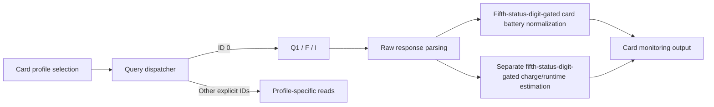

# KSTAR KPM220 MegaTec protocol notes

## First result and confidence

**High confidence, static card code:** the plain `MegaTec-1:1` profile queues `Q1\r`, `F\r`, and `I\r`; it does not queue the extended reads below on that polling path. The gateway already implements those three queries. This is an analysis of an SNMP-card application, not the UPS controller firmware. The owner's Sinus EVO 3000 has supplied Q1 data; no hardware was accessed in this analysis. `I` was reported with blank manufacturer/model and firmware `V142B000D0`.

**Medium confidence, owner-specific interpretation:** the owner reports six 12 V, 9 Ah batteries (72 V nominal) and a Q1 battery field around 2.25 V. If per 2 V cell, 36 cells imply about 81 V. This is plausible, not proof of the Sinus scale. Compare an independent pack-voltage measurement; do not infer a multiplier from `F` alone.

The gateway already exposes an explicit `battery_multiplier`; zero disables normalized pack voltage. Keep the raw Q1 value and require an operator-selected factor. Do not automatically add extended probes or setters for this UPS.

## Profile-to-query map

Commands are ASCII and CR-terminated. These are *card profile* behavior, not demonstrated Sinus capabilities. Additional reads precede shared Q1/F/I; flags make `F`, `I`, and `GF` conditional. IDs come from the profile selector and dispatch.

| ID | Card profile | Additional reads | Evidence, VA |
|---:|---|---|---|
| 0 | MegaTec-1:1 | None in this poll dispatcher | `0xa47e8–0xa48a4`, `0xa4940–0xa4964` |
| 7 | MegaTec-1:1-GP | None in this dispatcher; shares Q1/F/I | `0xa47e8–0xa4838` |
| 8 | MegaTec-3:3 | `G1`, `G2`, `G3`, conditional `GF` | `0xa48a8–0xa493c` |
| 14 | Megatec-1-1-EXT | `BT`, `BP`, `NQU`, `A1` | `0xa4a50–0xa4adc` |
| 20 | MegaTec-1:1-EXT-2 | No additional reads identified in this dispatcher; its response handling differs | `0xa47e8–0xa4838`, `0xa7b00–0xa7b10` |
| 25 | Voltronic Winner Pro 1–3K | `QMOD`, `QGS`, `QBV` | `0xa4ae0–0xa4b4c` |
| 26 | MegaTec-3:1 | `G1`, `G3` | `0xa4b50–0xa4b98` |
| 27 | Pyramid DSP | `Q2`, `SEC`, `BYB`, `INN`, `ALR`, `BTT`, conditional `GF` | `0xa4968–0xa4a4c`, `0xa4b9c–0xa4bc0` |
| 28 | Forte | `Q2`, `SEC`, `BYB`, `INN`, `ALR`, conditional `GF` | `0xa4968–0xa4a28`, `0xa4b9c–0xa4bc0` |

Pyramid DSP and Forte are not established equivalents of Sinus EVO. ID 5 (Jeida) also takes the G1/G2/G3 branch. Both conditional GF branches converge on the four-byte `ALR\r` enqueue (`0xa4a00–0xa4a20`); actual serial execution remains unverified.

## Plain-profile replies and derived values

Response lengths below are those checked by the card's receive handler, including its CR-delimited frame. Format strings denote parsed values, not fixed field offsets unless stated.

| Read | Card parser and values | Evidence |
|---|---|---|
| `Q1` | Requires `(` and length 47; format `(%s %s %s %s %s %s %s %d\r`. In order: input V, fault input V, output V, load %, input Hz, raw battery value, temperature, eight status digits. There is no measured output frequency/current, battery charge, or runtime field in this reply. | dispatch `0xa917c`, `0xa92ec`; parser `0xa7898–0xa7a24`; status `0xa7784–0xa7854` |
| `F` | Requires `#` and length 22; format `#%f %hu %f %f\r`: rated output V, rated current, nominal battery V, nominal frequency. Card exports the third field multiplied by 100; it is not a cell-count query. | queue ID 9; parser `0xa7f90–0xa8048` |
| `I` | Accepts `#` or `!`, with lengths 34, 39, or 61. For 39/61, copies bytes 1–15, 17–26, 28–37 as manufacturer, model and firmware; 61 also copies bytes 39–59 to the serial-number field (the same destination, setter `0x6a360`, that the EXT profile's `NQU` reply fills). For 34, it copies 10 bytes each at 1, 12 and 23. The gateway accepts all three layouts and both prefixes and shows the 61-byte extra field as the serial number. | queue ID 8; `0xa7e6c–0xa7f88` |

The card exports Q1 input/output V and input Hz in tenths, load in tenths of a percent, and its computed battery voltage in hundredths (`0xa6404–0xa653c`). These are card-side export scales, not evidence that the ASCII numbers need those multipliers to interpret their units. Output frequency/current are not direct plain-Q1 measurements; nominal frequency/current from `F` must not be relabeled as measured output values.

### Battery handling: three separate stages

The card packs the eight Q1 status digits left to right, starting at bit 0, so internal mask `0x10` tests the fifth wire digit (one-based; packing at `0xa7784–0xa7820`, tests at `0xa7aa4` and `0xa7b70`). Its operational meaning is not established by this card-code analysis. This fifth-digit mapping supersedes the earlier incorrect interpretation of this mask.

1. **Raw parse.** Q1 field six is converted to a float and stored unchanged at response structure offsets `+18/+20` (`0xa79ec–0xa7a0c`).
2. **Conditional display normalization.** For profile 0, if the fifth Q1 status digit is `0` and both configured factors are nonzero, the card stores `raw × battNum × battSingle`; if either factor is zero it stores raw. If the fifth digit is `1`, the plain profile stores raw instead (`0xa7a94–0xa7afc`, `0xa7c70–0xa7ca4`). Do not infer that this asymmetry corresponds to a mains/battery transition or a universal device rule.
3. **Separate charge/runtime estimates.** When mask `0x10` is set, the card passes raw Q1 voltage and nominal battery voltage from `F` to `0x75f34`, which estimates a clamped percentage using a nominal/24 scale and 20.0–27.2 voltage bounds. When the mask is clear it calls a separate load/voltage estimator (`0xa7b60–0xa7c2c`); runtime is calculated from estimated charge, load, and card tables (`0xa7b9c–0xa7bf0`). These are estimates, not values returned by Q1. The formula's assumptions and zero/invalid nominal handling are not validated for Sinus.

Card JSON maps `battNum` to `+320` and `battSingle` to `+322` (`0xe96b4–0xe96f8`; request writes `0xe9fd4–0xea090`). The English UI calls them “Quantity of Batteries” and “Number of Single Battery Pack”; the latter's example says “12V battery fill 6; 2V Battery Fill 1.” The Chinese placeholder for the former describes battery blocks in one group. The owner's 6 blocks × 6 cells is consistent with this card convention, not proof of what the UPS emits. An earlier analysis note that the card never multiplies Q1 was incorrect; the status-gated branch above supersedes it.

## Controls and settings

The card queues controls through the same MegaTec handler; actual device acceptance, ACK/NAK syntax, and physical outcome were **not established**. A sent command is not proof of execution. The plain response dispatcher (`0xa917c`) handles read IDs 0, 8 and 9 but no matching ACK parser was established for ordinary control IDs. Keep the gateway's send-only result semantics unless a device trace proves more.

| Operation | Card wire format and observed limit | Gateway |
|---|---|---|
| Buzzer toggle | `Q\r` | Implemented |
| Short self-test | `T\r` (UI labels it 10 s) | Implemented |
| Cancel self-test | `CT\r` | Implemented |
| Test to end of discharge | `TL\r` | Implemented as `test_deep` |
| Timed self-test | `T%02d\r`; card UI accepts 1–99 minutes, binary caps at 99; time 0 enqueues nothing | Implemented as `test_timed`, 1–99 min |
| Cancel shutdown | `C\r` for ordinary profile | Implemented |
| Delayed shutdown | `S.%d\r` for sub-minute delay or `S%02d\r` for minutes; card clamps ordinary-profile delay to 12–600 s | Implemented: 1–10 min, or 12–54 s in 6 s steps (`S.2`–`S.9`) |
| Shutdown and restart | `S.%dR%04hu\r` or `S%02dR%04hu\r`; card clamps shutdown delay to 12–600 s and restart field to at most 9999 | Implemented: same delays, restore 3–9999 min |
| Reboot | `R\r` encoder exists (logs "UPS reboot."), but no caller was found in v1.4.27 or v1.3.13; the card's SNMP `upsSmartControlRebootUps` sends `S.2R0000` instead | `R` not implemented: no caller, and `R0000` semantics are unknown. The gateway's SNMP `upsAdvControlRebootShutdownUps` sends `S.2R0003` (see `OIDS.md`) |

Sender literal references: `Q` `0xa4ef0`; `T` `0xa4fac`; `TL` `0xa5090`; `CT` `0xa5018`; `T%02d` `0xa505c`; `R` `0xa50d0`; `S.%d` `0xa51e8`; `S%02d` `0xa51ac`; `C` `0xa52cc`; restart formats `0xa5394`, `0xa541c`. Their enqueue calls are in `0xa4ee8–0xa5464`; literal file offsets are `0x494598–0x494624`. Card delay quantisation (`0xa513c–0xa5290`): input in seconds; ≤ 11 s becomes 12 s; 12–59 s sends `S.<floor(s/6)>`; 60–600 s sends `S<floor(s/60)>`; profile 7 caps at 540 s. The gateway accepts only values that encode exactly (no silent rounding). Real UPS acceptance remains unknown. `SOFF`/`SON` are branches for profile 25, not established plain-profile commands.

Callers: browser self-test `cmdType 7` (`0xd3224`), power `cmdType 9` (`0xd3380–0xd33f0`; sleep = `S.2R<min>`, shutdown = minutes × 60 s), buzzer `cmdType 8`; SNMP `upsSmartControlRebootUps` = `S.2R0000` (`0x6c574`), `upsSmartControlUpsSleep` = `S.2R<configured min>` (`0x6c6cc`), `upsSmartControlUpsOff` = shutdown after the configured delay (`0x6c4fc`), `upsSmartControlFlashAndBeep` = `Q` (`0x6c824`), `rfc1628UpsRebootWithDuration` = `S.2R<floor(value/60)>` (`0x72878`); these act only on value 2, value 1 returns success without action. The scheduler reuses the same encoders (`0x48720–0x48a20`). Every control is queued with priority 1 and reported as successful right after enqueue.

The WebUI Basic Parameters form submits protocol, device ID, battery quantities, full/empty/calibration voltages, replacement date, logging interval and serial settings as card configuration (`list2_1.html:58–139`, `js/list2_1.js:260–282`). Voltage labels specify 0.01 V; the UI requires full > empty. These are not UPS setters. No plain-profile wire setter for rated battery voltage, charger configuration, output voltage/frequency or battery capacity was established in the reviewed dispatch; other settings and ranges remain unknown. All 35 direct callers of the queue helper `0xa45d4` are 25 poll sites and 10 control sites. A separate debug writer `0xa3198–0xa31f4` sends a caller-supplied buffer; its callers are not established, so a binary-wide "no UPS setter" claim is not proven.

## Selected extended response evidence

These formats are useful only after the corresponding profile is independently established. `BT` accepts `#%hu %f\r` (length 12); `BP` accepts `#%d\r` (length 6), converts the integer ×0.1 and stores it as a floating value (`0xaa604–0xaa6fc`). The labels and physical units of every field are not fully resolved. `G1` accepts `!%hu %hu %hu %f %f %f %f %f\r` (length 41–42; `0xa832c–0xa83a0`); `G3` accepts four groups of three floats (`0xa891c–0xa89ac`). `QBV` accepts `(%f %hu %hu %hu %hu\r` (length 21), and the handler maps one integer to a charge-like value and another ×60 to runtime-like storage (`0xa8d1c–0xa8dcc`). Field names, units, and response layouts of the remaining extension queries are unresolved; do not promote them to supported Sinus measurements.

## Evidence and verification

- KPM220 v1.4.27 container SHA-256 `600cd7976fa334280d3d982470aaec504609978e90adc2599f9303bf5aaad562`; extracted `APP/MainRoutine/kstar-snmp` SHA-256 `69e7d966db6db5fc9690654508a089c679472691197d1e77be1d311586bbae6c`.
- ARM ELF32, stripped; exported `UPSMegatecPrivate` / `UPSMegatecHandler` symbols anchor the analysis. Addresses above are ELF virtual addresses. In the text/rodata region, file offset = VA − `0x8000`; for example the `Q1\r` literal is VA `0x49c570`, file offset `0x494570`. `objdump`, `nm`, and static byte inspection only; no firmware execution.
- Packaged profile names: `APP/WebServer/lighttpd-docs/htdocs/list2_1.html` and `json/languages/lang_english.json`. Packaged UI evidence is static and does not prove UPS-side writes.
- Recommendation: retain the existing Q1/F/I and manually configured multiplier; compare raw and independently measured pack voltage under both mains and battery states before choosing a factor. Add fixture tests for blank identity, raw versus normalized battery, and unknown charge/runtime/output Hz/current. Timed/deep tests are optional later work, not a reason to send commands during this analysis.
